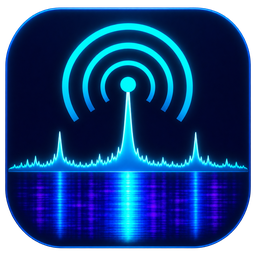

# SDR Workbench

**One front panel for many radios. Use your ANAN, Hermes Lite 2, FlexRadio,
Kenwood TS-890S or TS-990S, or a USB receiver from your Windows PC or Mac,
with the same keys, meters and bandscope for each.**

 

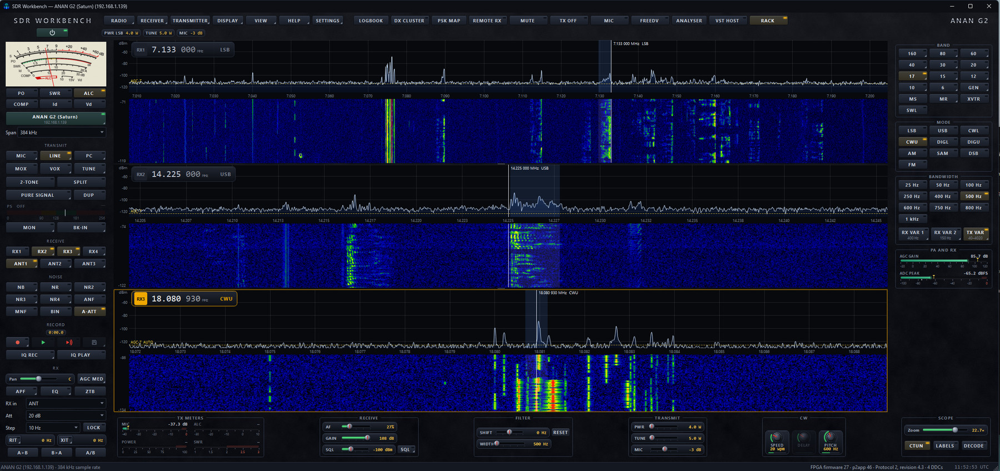

*An ANAN G2 listening on three bands at once: 40 m, 20 m and 17 m, each with
its own bandscope and waterfall. Along the top are the menus and the tools.
On the left are the meter and the transmit, receive and noise keys. On the
right you choose the band, the mode and the filter width, and the sliders
for volume, filter, power and CW run along the bottom. The controls follow
the receiver you click, and its outline shows which one that is.*

You learn one panel and use it with every radio you own. SDR Workbench shows
only what the radio in front of it can do, so a receiver shows no transmit
keys and a Kenwood shows the Kenwood's own filters. The panel lays itself
out to fit your screen, from a laptop to a wide monitor, and you can move
any group of controls with Ctrl+E.

Everything runs on your own computer. There is no account to make and
nothing to sign in to.

## New in 1.1.0: updates from inside SDR Workbench

SDR Workbench now tells you when there is a new version. Once a day it looks
at this page, and when a new release is out, a window shows what is new in
it. **INSTALL** downloads it, checks it against the checksum published with
it, and installs it. SDR Workbench closes for the installer and opens again
when it is done, with your settings as they were. It never installs while
you transmit. **SKIP** leaves that version alone, **LATER** asks again
tomorrow, and **HELP**, then **Check for updates**, looks straight away. To
turn the daily look off, open **Settings**, **General**, **Options**. On a
Mac the key is **DOWNLOAD**, and the new disk image comes down in your
browser.

You install 1.1.0 itself by hand, as before. From the next version on,
SDR Workbench can do it for you.

Also new in 1.1.0: on a TS-890S or TS-990S, the bandscope now shows the audio
you send while you transmit, at your transmit frequency and on the side your
mode puts it, wherever the radio shows nothing of its own.

## The EQ RACK

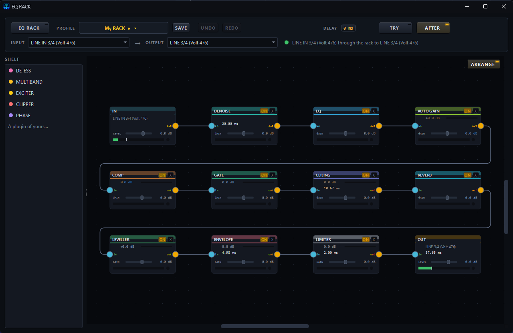

*The EQ RACK is SDR Workbench's own set of transmit audio units, from an EQ
and compressors to a limiter, with your own VST 3 plugins among them, on
every radio that transmits. It works like the VST HOST. Draw a line from one
unit to the next, run units side by side and they are lined up in time, and
set each unit's level with its own GAIN and meter. ARRANGE lays the board out
for you. Here a Volt 476 audio interface's LINE IN 3/4 goes through eleven
units and out of its LINE 3/4 to the radio, with a LEVEL for each.*

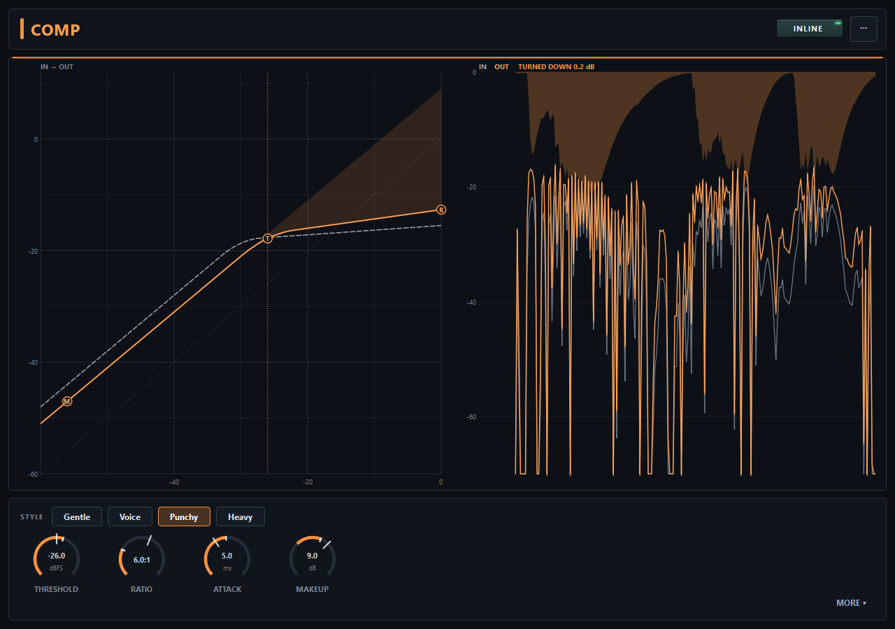

*Click a unit and it opens in a window of its own, with your voice live on
its picture. Point at a style and the picture shows what it would do before
you click it, and TRY plays your own voice through the whole rack without
transmitting.*

## The radios it works with

- **Apache Labs:** the ANAN G2, Orion MkII and Angelia, and the ANAN 10,
  100, 100D and 200D, with PureSignal.
- **Hermes Lite 2** and the openHPSDR Metis boards.
- **FlexRadio:** the FLEX-5000A and 5000C on FireWire (Windows only), and
  the FLEX-6000 and 8000 series over your network.
- **Kenwood:** the TS-890S and TS-990S, over USB or over your network.
- **USB receivers:** RTL-SDR dongles, the Airspy R2, Mini, HF+ and HF+
  Discovery, the SDRplay RSP family, and the RX888 MkII (Windows only).
- **The simulator,** so you can learn the panel before you connect anything.

The FLEX-6000 and 8000 series and the EU1SW Brick 2 follow their makers'
published information but have not yet been tried on a real radio.

## The same panel on every radio

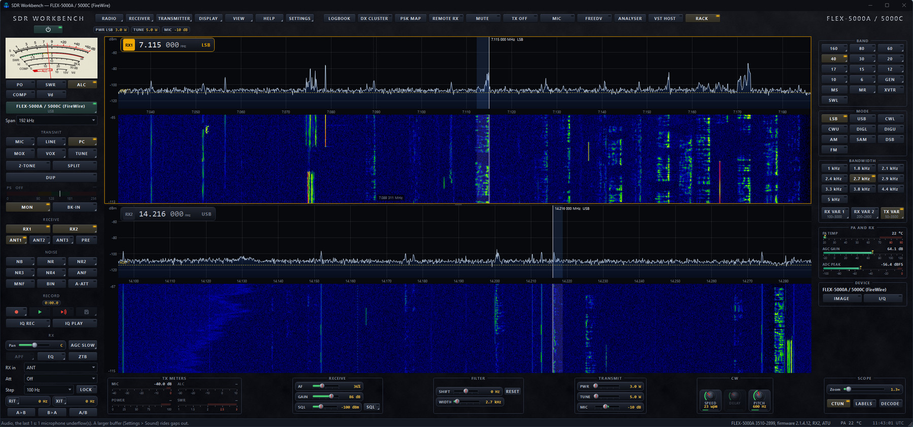

*A FLEX-5000A with its second receiver on 20 m. The panel is the same, and
the radio's own keys, for image rejection and swapping the IQ, are in the
DEVICE group on the right.*

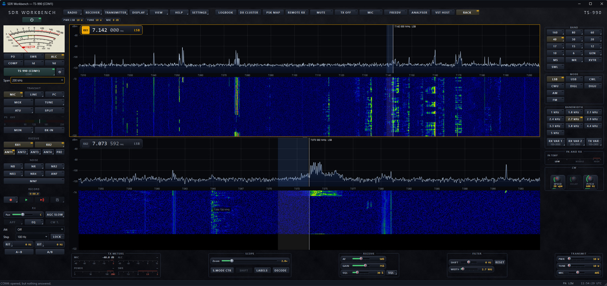

*A Kenwood TS-990S. RX2 is the radio's sub band, with its own antenna, mode
and filter, and the bandscope comes from the radio itself.*

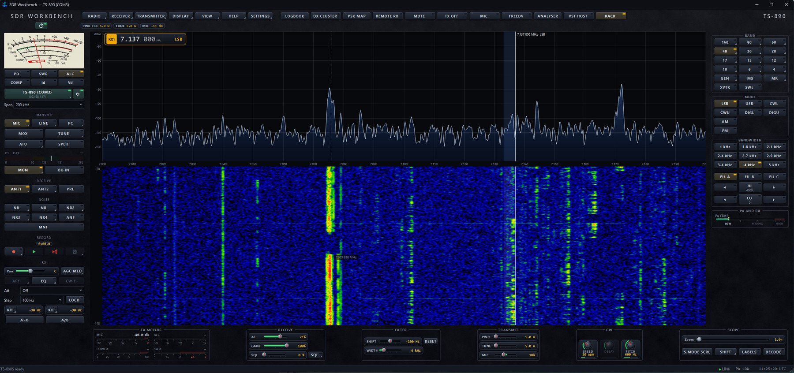

*A Kenwood TS-890S. The radio does its own processing, so the panel works
the radio's own filters, its scope and its keys.*

## A closer look

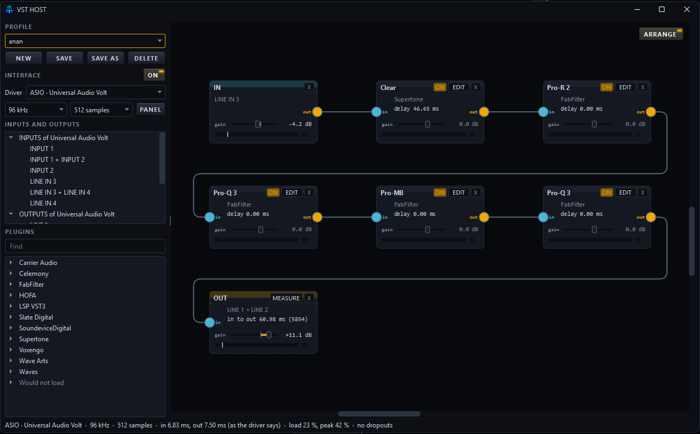

*The VST HOST runs your audio interface through your VST 3 plugins and out
to your radios, in a row or side by side, with every delay lined up. Here a
microphone goes through five plugins, one after another, at 96 kHz.*

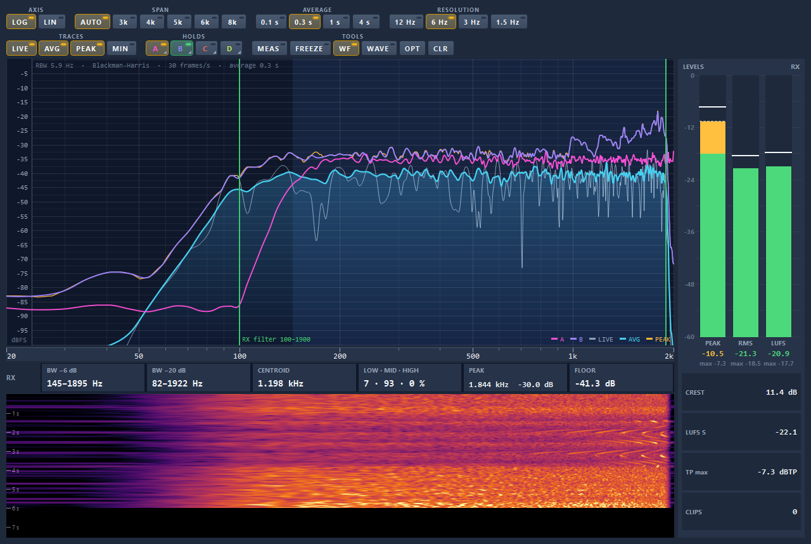

*The Audio Analyser shows what you receive, or your own transmit audio, with
four holds to compare before and after, and levels, loudness and distortion.*

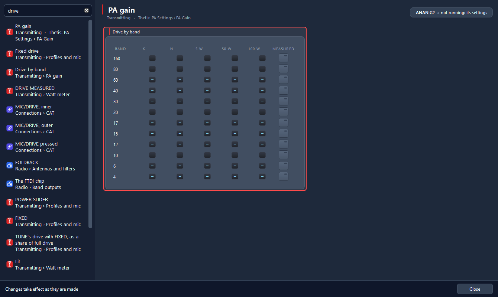

*All the settings are in one window. Type a word in Find a setting and it
takes you straight there.*

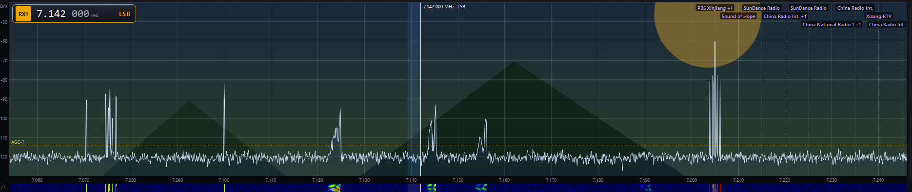

*Put any picture you like behind the bandscope.*

There is much more: power calibration for your own radio, a logbook, a DX cluster with alerts, CW, RTTY and PSK
decoding, FreeDV, recording and playback, KiwiSDR and UberSDR receivers
tuned along with your radio, CAT and TCI for your other programs, and
operating from away from home through a Raspberry Pi.

## Download

From the [latest release](https://github.com/lmacc/SDR-Workbench-Releases/releases/latest):

- **SDR-Workbench-&lt;version&gt;-setup.exe**: the installer for Windows 10
  and 11 (64-bit).
- **SDR-Workbench-&lt;version&gt;-macos.dmg**: for macOS 13 and later, on
  Apple silicon and Intel Macs.
- **libspecbleach** and **codec2 source zips**: the source of two libraries
  SDR Workbench uses, offered as their licence asks. You don't need them to
  run it.
- **SHA256SUMS.txt**: a checksum for each file.

> **"Windows protected your PC"?** The installer isn't signed. Click
> **More info**, then **Run anyway**. On a Mac, the README in the disk image
> says how to open it the first time.

From 1.1.0 on, SDR Workbench offers each new version itself, so you only
download it here the first time.

## Before you start

- **A network radio** (an ANAN, Hermes Lite 2 or FLEX-6000): connect it to
  the same network as your computer. Add Radio finds it for you.
- **A Kenwood:** for USB, install Kenwood's virtual COM port driver so the
  radio's ports appear. For the network, set up the radio's LAN screen with
  its address and login.
- **A USB receiver on Windows:** if Windows has it on the wrong driver,
  SDR Workbench offers to fix it for you the first time.
- **A USB receiver on a Mac:** install its library with
  [Homebrew](https://brew.sh): `brew install librtlsdr airspy airspyhf`. An
  SDRplay RSP needs SDRplay's own API from sdrplay.com.
- **A FLEX-5000A:** SDR Workbench brings FlexRadio's own driver and offers
  to install it.

The user guide is inside the application, under **HELP**, then
**User guide**. It covers every control and how to set everything up, with
pictures.

## Calibrating your radio

Some radios need no calibrating at all, and the others start from sensible
figures. The guide's chapter 26 explains each one step by step.

- **Kenwood TS-890S and TS-990S, FLEX-6000 and 8000:** the radio calibrates
  itself. There is nothing to do.
- **FLEX-5000A:** SDR Workbench reads the radio's own calibration from its
  memory every time it starts. There is nothing to do.
- **ANAN G2:** starts from power and frequency figures measured on a real
  G2, so it is close straight away. Measure your own to make it exact.
- **Other ANANs:** start with a cautious power curve, so the PWR slider gives
  less than it says until you measure yours.
- **Hermes Lite 2:** its power works in its own fixed steps, so there is no
  power curve to measure.

**Measuring your power** takes about a minute a band. You need a dummy load
and a wattmeter; never do it into an antenna.

1. With the radio running, open **Settings**, then **Transmitting**, then
   **PA gain**, and press **CALIBRATE**.
2. Pick the band, set **Most** to the highest power you are happy with, and
   light **DUMMY LOAD**. Nothing transmits until you do.
3. Press **KEY**. A steady carrier goes out for four seconds. Read your
   wattmeter, type the reading in and press **ADD**.
4. Repeat for the next step. After about four carriers the band is done.
   Press **SAVE**, and the PWR and TUNE sliders use the new figures at once.

The first carrier is always low, and no step that would go over your Most
is keyed. The S meter, the frequency and the watt meter are set on the
**Calibration** and **Watt meter** pages in Settings.

## SPE Expert amplifiers

SDR Workbench can show an SPE Expert 1.3K-FA, 1.5K-FA, 1.5K-FA Taurus or
2K-FA on its panel and work its keys, through the amplifier's USB port, or
its RS-232 port with the cable SPE's manual shows: operate and standby,
tune, the power level, antenna and input, its output, SWR, temperature and
band, and its warnings and alarms. It can stop transmitting the moment the
amplifier raises an alarm, and keep the amplifier on your band. Set it up in
**Settings**, then **Connections**, then **Amplifier**.

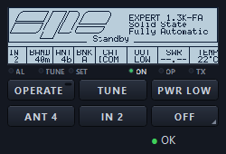 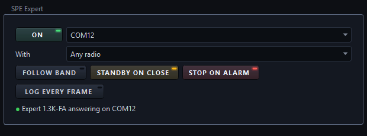

The AMP module and its settings, showing the reply recorded from a real
Expert 1.3K-FA in standby on 20 m.

A user's 1.5K-FA Taurus has worked with it on its USB port, its output, SWR,
volts, current and temperature read while transmitting at over 1000 W. If
yours doesn't answer as it should, the Amplifier page says why, and the
guide's chapter 27 explains how to save a log for an Issue. The 1K-FA isn't
supported yet.

## Licence keys

SDR Workbench works fully for 14 days from the first time you start it.
After that it needs a licence key for your computer. A key costs EUR 20 or
more and is yours for good, with free updates.

1. Open **HELP**, then **Licence key**, and press **COPY** to copy your
   computer's code.
2. Press **GET A KEY**. PayPal opens in your browser. Paste your code in the
   note with your payment.
3. Your key comes back by email. Enter that email address, paste the key
   and press **ACTIVATE**.

A key works on one computer. For another computer, get a key with that
computer's code. Keys for the TS-890S Desktop and TS-990S Desktop apps don't
work in SDR Workbench.

## Use at your own risk

SDR Workbench is provided "as is", without warranty of any kind. It controls
a radio transmitter, and you use it entirely at your own risk. To the
fullest extent the law allows, I accept no responsibility or liability for
any damage, loss or harm arising from its use or from being unable to use
it. That includes damage to your radio, amplifier, antenna or other
equipment, loss of data, and interference caused to others. You are
responsible for your station: for how it is set up, and for operating it
within your licence and the regulations that apply to you.

SDR Workbench is not made by or endorsed by Apache Labs, FlexRadio or
JVCKENWOOD. ANAN is a trademark of Apache Labs. TS-890S, TS-990S and
KENWOOD are trademarks of JVCKENWOOD.

## Problems and suggestions

Please use [Issues](https://github.com/lmacc/SDR-Workbench-Releases/issues).
Say which version you have (**HELP**, then **About SDR Workbench**, shows
it) and which radio, and what you did just before the problem. If SDR
Workbench closed unexpectedly, the Message Centre says what happened the
next time it starts: please include that line.

73, Leslie EI5GJB
